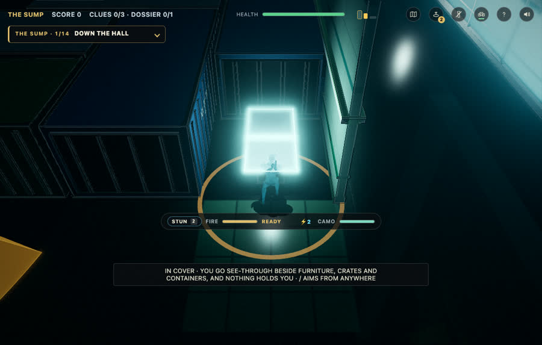
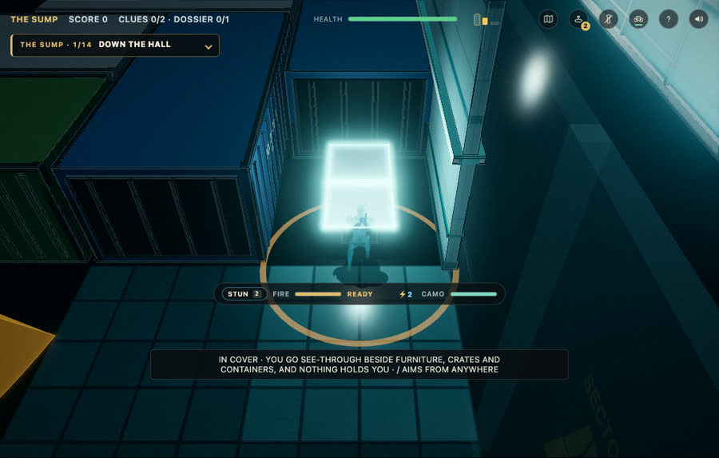
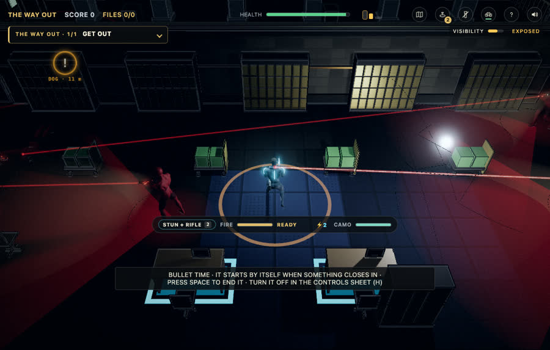
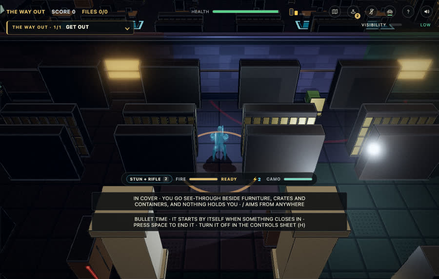
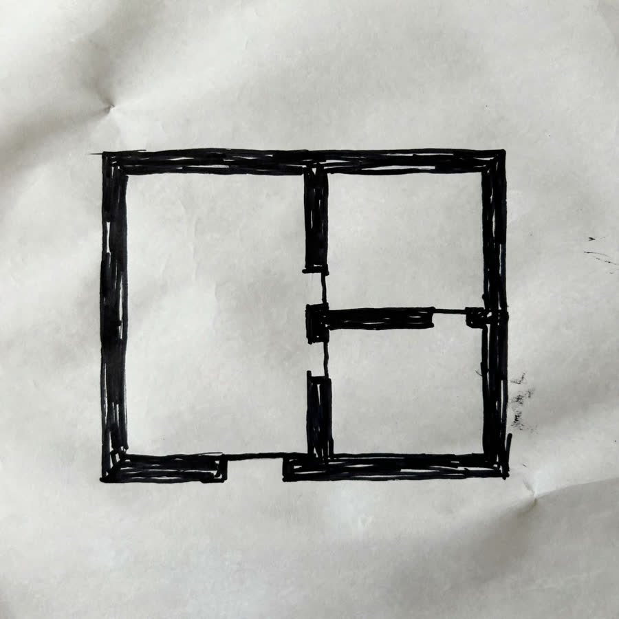
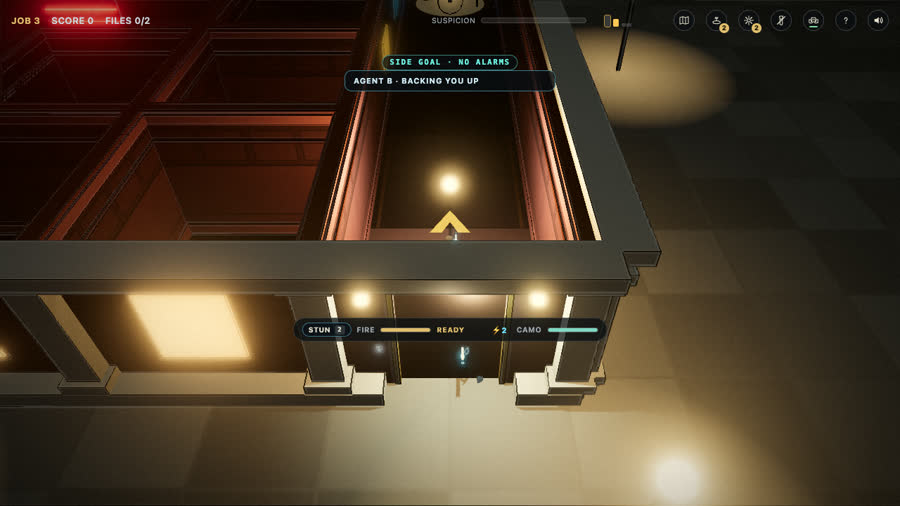
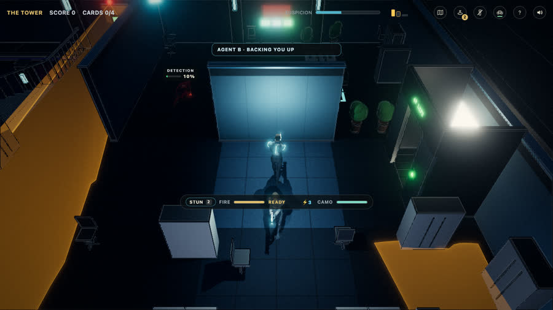
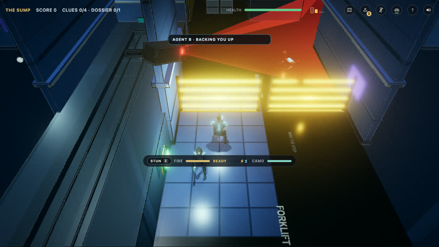
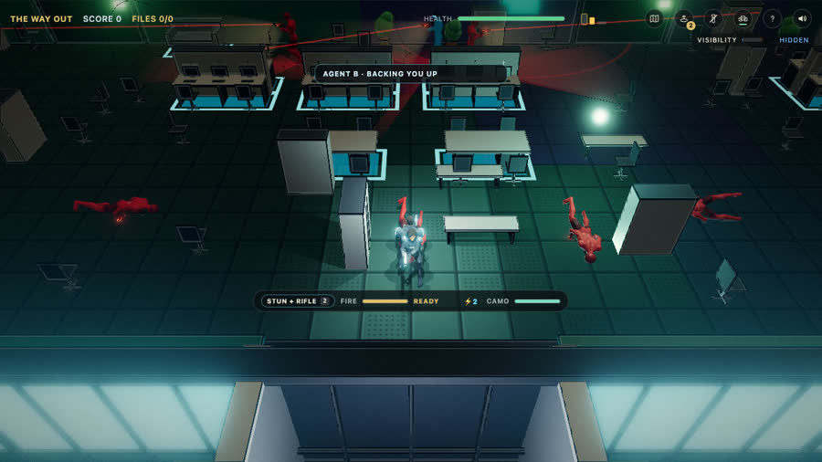

# Project history

A running log of every commit: what was asked or decided (the **input**), what came out and how it was checked (the
**output**), and what it means in plain terms. At the end of each phase there is a summary of what was achieved.
Newest work goes at the bottom. Times are IST, Oct 26, 2026 (the day the hackathon kicked off at 12:00 PM ET,
09:30 PM IST).

**How this file is kept:** after each commit, add one entry in the same shape; at the end of each phase, add a phase
summary. Screenshots live in [`img/`](img/). Entries for the last few commits are added in the commit after them, because a commit
cannot name its own hash.

Phase names follow [`PLAN.md`](PLAN.md): **0 Setup**, **1 Foundations and spikes**, **2 Voice and Director v1**,
**3 Photo to map and repair loop**, **4 Story layer and exit level**, **5 Harden and film**, **6 Submit**.

---

## Phase 0: Setup, plan and the baseline (Oct 26, 14:43 to 17:20, plus planning docs in the evening)

### 6a5c6c4 · 14:43 · Add initial README and .gitignore
- **Input:** you asked for the project's first README after I read the Cerebral Valley event page (rules, tracks, prizes,
  schedule) and we settled the idea: Operation Blueprint in 3D, with four demo levels and Meta's models.
- **Output:** [`README.md`](../README.md) (what the project is, the four AI features, the four demo levels, what counts as
  new work, the planned architecture) and `.gitignore` (keeps `.env`, `node_modules`, build output out of git).
- **In plain terms:** the front door of the project. It says honestly that nothing is built yet, so no one reading it is
  misled, and it sets up the rule that secret keys never get committed.

### 94029bb · 14:47 · Add interactive HTML readme
- **Input:** you asked for an interactive page you could read, not just a markdown file.
- **Output:** [`docs/index.html`](index.html), one self-contained page: a filter that shows which Meta model powers which
  feature, feature detail flows, a level table, a tickable phase list (saved in your browser), a storyboard of the
  3-minute video, scope tiers, risks and a deadline countdown. Checked in a browser: no console errors, no sideways
  scroll at phone width.
- **In plain terms:** the plan as something you can click through, so you can see the whole project at once.

### 7c200d7 · 14:47 · Add project plan: Meta model use, expected result and phases
- **Input:** you asked for the details: what we intend to build, how each Meta model is used, what we expect at the
  end, then phases from the timeline. I had read Meta's API documentation (model list, pricing, image, SAM, voice,
  structured output) to ground it.
- **Output:** [`docs/PLAN.md`](PLAN.md): goal, the rules that shape the work, how each model is used, the four levels, the
  expected result against the four judging criteria, scope tiers (Must, Should, Stretch), the phases with dates, the
  demo video storyboard, hosting, risks.
- **In plain terms:** the written plan everything else is measured against. Two facts from the docs corrected my first
  brainstorm: Muse Wonder is a coding and agent model, not a creative one, and Meta has no text-to-speech.

### 69b074f · 15:51 · Baseline: game engine and mechanics carried over from the earlier project
- **Input:** you asked for the game's levels in the public repo with its mechanics but none of its story, and with
  only assets we may redistribute (CC0). Source: the `feat/tower` branch of your private game.
- **Output:** 338 files, 76,896 lines: the 3D engine, movement, guards, dogs, cameras, lasers, combat, the maze, tower,
  bunker and shootout-exit levels and their tests, as a standalone web build. The story's letters, cutscenes, characters,
  voice files and one story level were replaced by neutral stubs or removed, the boss renamed, and the original
  (Mixamo) character files swapped for CC0 ones. Checks: type-check clean, lint clean, 836 unit tests pass, every
  level played headlessly by a test helper (all four ran with no errors; the later co-op rounds repeated this).
- **In plain terms:** the starting line. Everything judges will be told is "carried over" is in this one commit and its
  tag, `baseline-pre-hackathon`, so everything after it can be told apart. It still plays like your game, with plainer
  character bodies.

### 33eaae9 · 15:52 · Add the original-animation build mode and its restore script
- **Input:** you played the baseline and said the crouch, the walk and the way the gun is held looked different. I
  compared it to your original, found the cause (the CC0 swap), and you chose the hybrid: the public repo uses CC0,
  the live demo uses your original animations from a private folder.
- **Output:** `npm run build:original` (a Vite mode that overlays ten original source files and serves the original
  models from `public/models/private/`, both git-ignored) and `scripts/restore-private-assets.sh`. A headless smoke test of
  the tower loaded your original guard, agent and crouch files with no errors.
- **In plain terms:** two builds of the same game. Anyone can build the public one; only you can build the one that
  looks exactly like the original.

### 6bcb47a · 15:54 · Add the three sound effects, from Pixabay, with their credit
- **Input:** you said the game's sounds come from Pixabay.
- **Output:** `alarm.m4a`, `emp-discharge.mp3`, `stun-shot.mp3` and a credit file. The code loads only these three audio
  files; everything else is synthesised.
- **In plain terms:** the missing sound effects are back, with the licence stated. Pixabay allows use in a game but not
  re-sharing the files on their own, which a public repo comes close to, so that risk is noted.

### 710daf1 · 17:20 · Keep the private rename rules out of the repo
- **Input:** the pre-push scan found the old boss's name inside the restore script.
- **Output:** the rename rules moved to a git-ignored file and the script reads them if present.
- **In plain terms:** closed a small leak going forward. The name is still in earlier commits (one script line);
  scrubbing it would mean rewriting history, which I offered and you haven't asked for.

### a6ea84e · 20:52 · Add the gameplay track: radio check-ins, habit counters, snipers, taller bunker
- **Input:** your play-test: all levels feel alike, it plays like run and gun, little reason to continue, the dog is
  easy, the alpha is no problem. I read the enemy code and suggested six ideas; you chose radio check-ins, counters to
  the player's habits, tower snipers, and for the bunker turrets, a taller space with sniper platforms, bridges, fans
  and hanging lamps.
- **Output:** [`docs/GAMEPLAY.md`](GAMEPLAY.md): each feature designed against the real code, constraints, a schedule.
- **In plain terms:** your feedback turned into a build plan, without building anything yet.

### fc2ec29 · 21:01 · Gameplay track: riot-shield guards are the shootout exit's signature threat
- **Input:** you chose riot-shield guards that need a flash grenade to open.
- **Output:** the design added: reuses the shield rules the Warden boss already has; flagged that the shield lives in a
  file the private build overwrites, so the change must be applied in both places.
- **In plain terms:** the exit level gets its own kind of enemy.

### f9a2215 · 21:10 · Docs: pre-event work is committed under its real date and tagged, not moved into the window
- **Input:** you asked why gameplay couldn't be built right away, since it's built with Claude and not Meta's models.
- **Output:** a correction in the docs. The tool doesn't matter; the date does. Work done before the building period is
  committed under its real date and tagged, not moved into the window. (I had said I would commit it on Oct 27, which
  would have misrepresented when it was made.)
- **In plain terms:** an honesty fix about the "new work only" rule.

### b99f6d2 · 21:19 · Gameplay track: the bunker platforms cost 19 to 25 days, so turrets, fans and lamps first
- **Input:** a read-only study of the bunker engine (no code changed), answering whether 8 m storeys, 6 m platforms,
  stairs, bridges and snipers fit.
- **Output:** the bunker is already tall (7 m storeys, 6 m walls); the full design costs about 19 to 25 focused days
  (most of it groundwork the game lacks: one height per storey, no height bands in collision, flat stun shots, partner
  support). Default chosen: turrets, fans and hanging lamps, 3 days; snipers stay in the tower; platforms deferred.
- **In plain terms:** the platform idea is great but too big for nine days alongside four AI features, so it moves to
  "later" and the cheap, visible parts go first.

### a4feea1 · 21:23 · Add the design for the four AI features
- **Input:** you asked me to finish the design and prep before the window opened.
- **Output:** [`docs/DESIGN.md`](DESIGN.md): the level spec, the verifier's layers, the Director's loop, the voice order
  grammar, the story layer, the photo-to-map pipeline, the repo layout, your morning checklist and the first two days'
  order. Grounded in the code's real difficulty options, contract ids, twist ids and places.
- **In plain terms:** the blueprint for the AI work, so building starts without redesign.

### Phase 0 summary
- **Achieved:** a public repo with a README, an interactive plan, a written plan, a story-free baseline of the game
  that plays all four levels, a private way to build it with your original look, the gameplay and design documents.
- **Checked:** 836 tests, lint, type-check, a headless play of every level.
- **Not achieved / honest limits:** the baseline's CC0 characters look plainer than the original (the private build
  fixes that for the demo); one old name remains in the history of one script.

---

## Carried-over work finished around the kickoff (tag `pre-hackathon-final`, 21:56 IST)

### 7192f48 · 21:56 · Pre-hackathon: partner on the tower, bunker and exit, lit bunker and exit, bunker stairs both ways
- **Input:** (1) you wanted co-op from the start of the game on every level; (2) you asked for the bunker and the shootout
  to be well lit; (3) you found a bug: leave a task on a lower bunker level, go up, and you cannot come back down.
- **Output:**
  - **Co-op:** the AI partner is switched on for the tower, bunker and exit (it was maze-only), with the first
    floor-to-floor routing.
  - **Lighting:** bunker lit with cool strip light, the exit with warm light and every storey known; checked in
    before-and-after screenshots below (`?dark=1` brings the bunker's darkness back).
  - **Bunker stairs:** cause found: a wall at the foot of each flight on the upper storey stopped anyone walking down,
    and the earlier test walkers hid it by teleporting. Fixed by opening that wall like the one at the head; verified on
    every flight of five bunker plans with real key presses, and the partner followed both ways. 842 tests pass.
- **In plain terms:** the three things you asked for tonight, committed and tagged as the line between carried-over and
  new work.

| Bunker, before | Bunker, after |
|---|---|
|  |  |

| Shootout exit, before | Shootout exit, after |
|---|---|
|  |  |

### 609907f · 21:59 · Plan: the VR path, kept open but not scheduled
- **Input:** you showed your application, which describes a VR game, and asked whether the game can be ported to VR later.
- **Output:** a "VR later" section in the plan: three.js supports WebXR, the game already has a first-person mode, what
  a port needs (VR input, a camera rig, in-world panels, comfort options, a lighter render profile). Not scheduled.
- **In plain terms:** yes, later; the submission stays the web build, and the plan keeps the door open.

---

## Phase 1: Foundations and spikes (started Oct 26 evening, ahead of the calendar)

### 453a572 · 22:03 · Add the /api/ai serverless scaffold
- **Input:** the design's rule that the Meta key must stay on a server, never in the browser.
- **Output:** 20 files: a small Meta client (chat, speech-to-text, images; retries on 429/503; the key is redacted from
  every error), rate limits, size caps, a response cache, five stub endpoints under `/api/ai/*` that answer 501 until
  they are built, a local runner (`npm run dev:api`), `vercel.json`, `.env.example`. 35 new tests, 877 total, all pass.
  Tested only against mocked responses because there was no key yet.
- **In plain terms:** the plumbing. When a model call is wired in, it already has safe limits and a safe place for the key.

### d7ddeff · 22:20 · Add the level spec, its clamp and schema, the verifier and a pure floor builder
- **Input:** the design's `LevelSpec`: one description of a level (place, layout, size, contract, twists, enemies,
  hazards, loot, seed) that a model can write and the game can build.
- **Output:** `levelspec.ts` (the type, a JSON schema shaped for model output, a clamp that never throws and reports
  what it changed), `verify.ts` (three layers: the spec, the grid, the placement, each with named failure codes),
  `floorbuild.ts` (builds a floor with the game's own generators, same spec and seed give the same floor). 43 new tests,
  920 total, pass. Findings that corrected the design: a literal "no laser blocks the way" fails about 70% of floors, so
  one crossing is allowed; the game caps guards at 4, not 6; tiny 6 x 5 floors rarely pass the exit-distance check.
- **In plain terms:** the part that lets an AI describe a level and lets us check, without playing it, that it is
  finishable.

### ba5171d · 22:20 · Add the API spike scripts and a sketch fixture; the SAM parser dependency
- **Input:** you added your Meta API key to `.env` and asked me to check it and run the spikes.
- **Output:** six small scripts in `scripts/spikes/` (structured output, Muse Image, SAM concept and box prompts, masks to
  a grid, speech to order) that call the API through the project's own client and scrub the key from any output; a
  test sketch generated by Muse Image; `@meta-sam/parser` as a dependency.
- **In plain terms:** repeatable experiments, not one-off commands. Anyone with a key can re-run them.

| A floor-plan "marker sketch" made by Muse Image (17 s, $0.01) |
|---|
|  |

### aeb38cf · 22:20 · Record the spike results and revise the photo-to-map and voice designs
- **Input:** the spike results.
- **Output:** [`docs/SPIKES.md`](SPIKES.md). Key results: the key works and lists every model; Spark returns valid JSON for a
  schema (3 to 4 s); **SAM cannot segment "wall" or "door"** (zero matches), but Spark finds the room boxes and SAM turns
  each box into a pixel-accurate mask, which a grid conversion turns into rooms with walls between them; the voice trip
  (speech to transcript to order) is exact but takes 4.2 to 4.5 s. Plan changes: photo to map keeps its go with a new
  pipeline (about 9 s), and obvious voice commands get a local fast path. Spark spends tokens on reasoning even at
  minimal effort, so calls need headroom in `max_tokens`.
- **In plain terms:** we found out early what works and what doesn't, and the plan now reflects it.

Rooms recovered from the sketch, as a 16 x 16 grid (digits are rooms, dots are walls and outside):

```
...1111122222...
...1111122222...
...1111122222...
...11111........
...11111.333....
...11111.3333...
...11111.333....
```

### f0acf37 · 22:24 · Co-op: last fixes from the all-levels test round
- **Input:** you asked me to play co-op on all levels and be thorough: you expected stairs, climbing and the rest to
  break it, since the maze has none of those hurdles. A helper tested a matrix of places, seeds, climbs, lifts, shafts,
  ducts, partner left behind, partner downed and revived, live guards.
- **Output:** the partner now spawns and follows on all four levels. Of 85 headless runs, 78 passed: tower 37 of 37,
  bunker 27 of 27, maze 6 of 8 (single flagged windows near a laser or a leader up on a wall), exit 7 of 9 in ghost
  mode (the two misses are the intended rule that a partner left downed for 45 s is lost) and 2 of 5 with live
  guards (read as harness limits, not ruled out). It routes by stairs and lifts, steers round furniture, opens office
  doors, recovers when stuck, and waits where it can't follow a climb. 920 tests pass.
- **In plain terms:** co-op works across all the levels, with known soft spots listed instead of hidden.

| Maze | Tower |
|---|---|
|  |  |

| Bunker | Shootout exit |
|---|---|
|  |  |

### ce1d426 · 22:34 · Add the project history: every commit in plain terms, phase summaries, screenshots
- **Input:** you asked for a record of each commit with its input, output and a plain explanation, a summary at the end
  of each phase, and screenshots where useful.
- **Output:** this file, with an entry for each of the first 19 commits, three part summaries, and 9 screenshots in
  `docs/img/` (about 0.5 MB): the bunker and exit before and after lighting, the partner on each of the four levels, the
  Muse Image sketch. Linked from the README and the interactive page.
- **In plain terms:** a diary of the project you can read without knowing git.

### Phase 1 summary (so far, in progress)
- **Achieved:** the API plumbing with a safe key path; the level spec and verifier; the Meta key tested against every
  model we plan to use; the three biggest risks (SAM on a sketch, structured output, voice latency) answered with real
  numbers; co-op on all four levels.
- **Numbers:** 920 unit tests (836 at the baseline), lint and type-check clean, 19 commits.
- **Still open in this phase:** loading a spec into the game (`?spec=`), the loop test (a layout with a loop, which the
  game's tree-shaped mazes never had), the Vercel deployment, and your three real sketch photos.
- **Next:** the loader and loop test (running now), then the Director's repair loop on the server, then the voice fast path.
